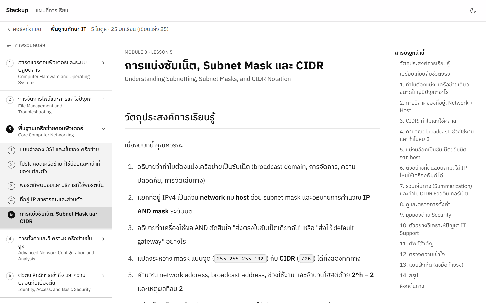
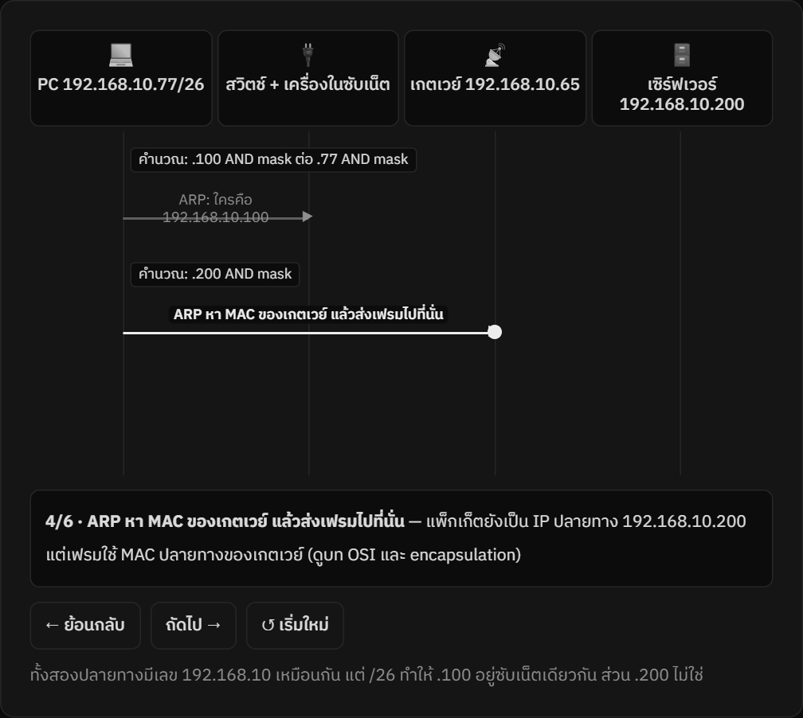
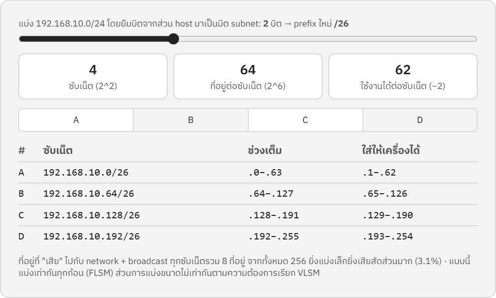
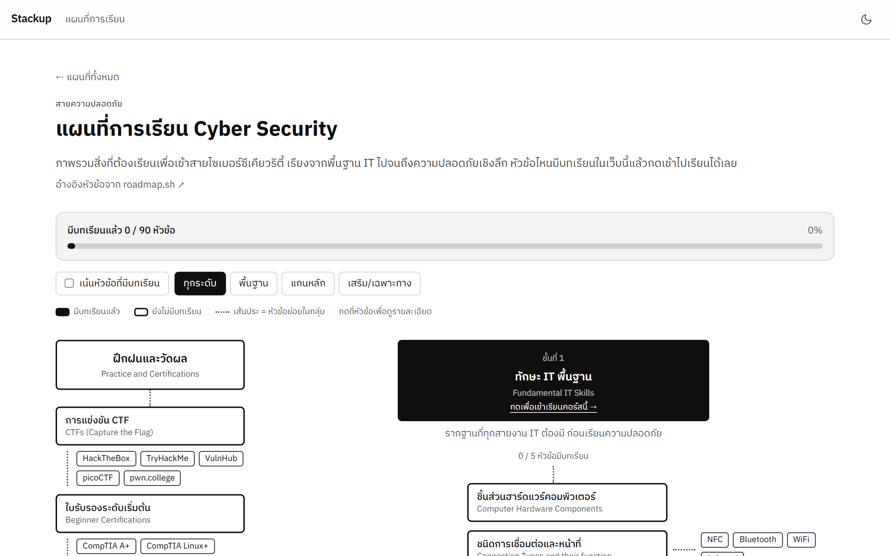

# Stackup

**เว็บเรียนรู้ IT และ Cyber Security ภาษาไทย ที่ให้ "ลองเล่น" แทนการท่องจำ**

บทเรียนเรียบเรียงใหม่จากคอร์สภาษาอังกฤษ ([roadmap.sh](https://roadmap.sh) — Fundamental IT Skills) เป็นภาษาไทย อธิบายลึกแบบเล่มเรียนมหาวิทยาลัย และแทบทุกแนวคิดมีสื่อโต้ตอบให้กดลองเอง เช่น จำลอง TCP handshake, คำนวณซับเน็ต, ลองสลับสิทธิ์ `chmod` แล้วดูผลทันที

> โปรเจกต์ส่วนตัวสำหรับเรียนรู้และทำเป็นผลงาน (Nuxt 4 + TypeScript) · เนื้อหา 25 บท · สื่อโต้ตอบ 75 ชิ้น



<table>
  <tr>
    <td width="50%"><br><sub><b>แผนภาพลำดับข้อความ</b> กดทีละขั้นดูว่าเครื่องตัดสินใจส่งตรงหรือส่งผ่านเกตเวย์</sub></td>
    <td width="50%"><br><sub><b>เครื่องคิดแบ่งซับเน็ต</b> ลากแถบยืมบิต แล้วตารางซับเน็ตเปลี่ยนตามทันที</sub></td>
  </tr>
</table>



<sub>หน้า Roadmap เชื่อมหัวข้อของสายงานเข้ากับบทเรียนที่มีในเว็บ · โหมดมืด: [docs/screenshots/lesson-dark.png](docs/screenshots/lesson-dark.png)</sub>

---

## จุดเด่น

### 1. เห็นภาพก่อน แล้วค่อยถึงศัพท์
ทุกหัวข้อเริ่มด้วยกล่อง **"นึกภาพว่า"** (อุปมาชีวิตจริง + ตัวอย่างตัวเลขทีละขั้น) ก่อนลงรายละเอียดทางเทคนิค ไม่ใช่เริ่มจากการท่องศัพท์

### 2. สื่อโต้ตอบเฉพาะเรื่อง ไม่ใช่แค่ข้อความ
สร้าง component เองด้วย Vue + SVG/CSS เกือบ 75 ตัว ตัวอย่าง

| หมวด | ตัวอย่างสื่อที่กดเล่นได้ |
|---|---|
| ฮาร์ดแวร์ | วงจรการทำงานของ CPU, Cache simulator, RAM/swap, ภายใน SSD (NAND/FTL), เทียบ SATA กับ NVMe |
| ระบบปฏิบัติการ | จำลองติดตั้ง Windows/Linux, จัดพาร์ทิชันดิสก์, inode, เทอร์มินัลจำลอง |
| สิทธิ์ไฟล์ | เครื่องคิด `rwx` ↔ ฐานแปด, umask, ตรวจสิทธิ์ตามพาธ, ลำดับ ACL ของ NTFS |
| เครือข่าย | แผนภาพลำดับ DNS/DHCP/TCP, เครื่องคิด Subnet/CIDR, NAT, การเรียนรู้ MAC ของ switch, Routing lookup, VLAN/DMZ |
| ความปลอดภัย | แฮช, Diffie-Hellman, TOTP (MFA), ห่วงโซ่ใบรับรอง TLS, การดักฟังแบบเข้ารหัสเทียบไม่เข้ารหัส, OS hardening |
| วิธีคิด | วงจรแก้ปัญหา 6 ขั้น, หาจุดเสียของเครือข่าย (top-down / bottom-up / divide and conquer) |

ทุกสื่อมีปุ่มเล่น/หยุด/ทีละขั้น/รีเซ็ต เคารพ `prefers-reduced-motion` และออกแบบให้ใช้บนมือถือได้

### 3. ลึกระดับมหาวิทยาลัย
- **กลไกภายใน:** ฟิลด์จริงใน header, ขั้นตอนของอัลกอริทึมทีละรอบ
- **เชิงปริมาณ:** สูตร + โจทย์คำนวณพร้อมเฉลย (ตรวจตัวเลขด้วยการคำนวณจริง)
- **ความแม่นยำ:** ระบุข้อจำกัดของแบบจำลองเสมอ ไม่อ้างเกินจริง
- **วินิจฉัยเชิงกลไก:** ตาราง IT Support ที่บอก "ทำไม" ไม่ใช่แค่ "ทำอะไร"
- **Security เชิงลึก:** แมปการโจมตี/การป้องกันเข้ากับกลไกที่เพิ่งเรียน
- **ลงมือทำจริง:** แบบฝึกหัดบนเครื่องตัวเอง (คำสั่งอ่านอย่างเดียว) + แนวคำตอบ
- ท้ายบทมีคำถามตรวจความเข้าใจแบบกดดูเฉลย

### 4. แผนที่ตำแหน่งงาน (Roadmap)
หน้า `/roadmap` เชื่อมหัวข้อของแต่ละสายงาน (เช่น Cyber Security) เข้ากับบทเรียนที่เขียนไว้ เห็นว่าบทไหนเรียนแล้ว บทไหนยังไม่ถึง

### 5. ดีไซน์ minimal ขาว-ดำ
โทเคนสีชุดเดียว สลับโหมดมืด/สว่างด้วย CSS variables อ่านสบายตา ใช้ฟอนต์ IBM Plex Sans Thai

---

## เนื้อหาที่มี (Fundamental IT Skills — 5 โมดูล 25 บท)

1. **ฮาร์ดแวร์และระบบปฏิบัติการ** — ชิ้นส่วน, การเชื่อมต่อ, ติดตั้ง Windows/Linux, GUI vs CLI
2. **การจัดการไฟล์และแก้ปัญหา** — CRUD, permissions, ระเบียบวิธีแก้ปัญหา, คำสั่งแก้ปัญหา Windows/Linux
3. **พื้นฐานเครือข่าย** — OSI, โปรโตคอล, พอร์ต, IP, ซับเน็ต/CIDR, loopback/gateway
4. **เครือข่ายขั้นสูง** — DHCP/DNS/NAT, routing/switching/VLAN/DMZ, ping/traceroute/nslookup, Wireshark
5. **ตัวตนและความปลอดภัยเบื้องต้น** — AuthN vs AuthZ, MFA/SSO, CIA Triad, TLS, OS hardening

---

## เทคโนโลยี

| ส่วน | ที่ใช้ |
|---|---|
| Framework | Nuxt 4, Vue 3, TypeScript |
| เนื้อหา | Nuxt Content 3 (Markdown + MDC component) |
| สไตล์ | Tailwind CSS 4, `@nuxtjs/color-mode`, `@nuxt/fonts` |
| สื่อโต้ตอบ | Vue component + SVG/CSS ล้วน (ไม่พึ่งไลบรารีกราฟิกภายนอก), composable `useStepper` ควบคุมแอนิเมชันกลาง |
| เตรียมไว้ | Supabase (Auth, บันทึกความคืบหน้า/โน้ต) — ยังปิดอยู่ |

เนื้อหาเขียนเป็นไฟล์ Markdown ตามโครง `content/<source>/<course>/<module>/<lesson>.md` และสื่อโต้ตอบเรียกใช้ด้วยไวยากรณ์ MDC เช่น

```md
::seq-diagram{:actors='[{"label":"Client"},{"label":"Server"}]' :messages='[{"from":0,"to":1,"label":"SYN"},{"from":1,"to":0,"label":"SYN-ACK"},{"from":0,"to":1,"label":"ACK"}]'}
::
```

ใส่แค่ข้อมูล ได้แอนิเมชันแผนภาพลำดับข้อความพร้อมปุ่มควบคุม

---

## สถานะโปรเจกต์

- ✅ เนื้อหา 25 บท + สื่อโต้ตอบ + หน้า Roadmap + โหมดมืด/สว่าง
- 🚧 ยังไม่ได้ deploy, ยังไม่มีระบบล็อกอิน/บันทึกความคืบหน้า (วางแผนไว้ด้วย Supabase)
- 🚧 ยังไม่ได้ทดสอบบนมือถือจริงครบทุกสื่อ
- เว็บตั้งใจให้ใช้ส่วนตัว (`noindex`) และเขียนบทเสริมตามหัวข้อที่อยากเข้าใจเพิ่ม

รายละเอียดการทำงานอยู่ใน [PROGRESS.md](PROGRESS.md) และ [REQUIREMENTS.md](REQUIREMENTS.md)

---

## รันบนเครื่อง

```bash
npm install --legacy-peer-deps
npm run dev -- --port 3100
```

บน Windows (PowerShell) ถ้าโหลดฟอนต์ Google ไม่ได้ ให้ตั้ง `$env:NODE_OPTIONS="--use-system-ca"` ก่อนรัน

```bash
npm run build       # build production
npm run typecheck   # ตรวจชนิดข้อมูล
```

---

## หมายเหตุด้านเนื้อหา

บทเรียนเรียบเรียงใหม่ด้วยภาษาของตัวเอง ไม่ได้คัดลอกข้อความจากต้นฉบับ มีลิงก์ต้นทางท้ายแต่ละบท ตัวเลขที่ไม่ได้มาจากต้นฉบับติดหมายเหตุว่าเป็นค่าประมาณ
